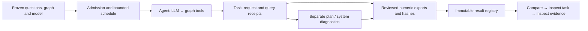
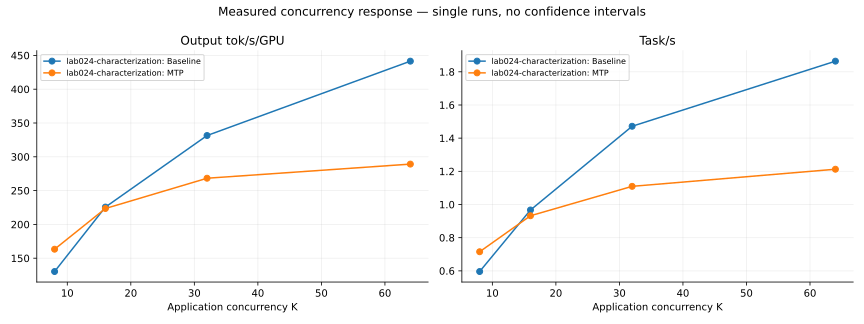

# GARE2E

**Reproducible graph-agent experiments, query evidence, and end-to-end observability.**

Graph agents alternate between LLM requests and database tools. A slow answer can
come from generation, repeated tool use, query execution, or waiting between
those stages. GARE2E records those boundaries and links a comparison result to
the condition, task, request, and query evidence behind it.

This repository develops the experiment harness, measurement adapters, evidence
exports, and comparison platform. Its primary user path is **inspect an existing
result → reproduce its analysis → register a controlled experiment**.

[Quickstart](QUICKSTART.md) · [Published results](docs/agentic-os/README.md) ·
[Experiment platform](docs/agentic-os/EXPERIMENT_PLATFORM.md) ·
[Project scope and provenance](docs/GARE2E_SCOPE.md)

## What GARE2E adds

| Capability | What you can inspect | Implementation / guide |
|---|---|---|
| Bounded experiment execution | Frozen workloads, admission gates, concurrency schedules, collection and teardown receipts | [Harness](docs/agentic-os/HARNESS.md), [`scripts/benchmarks/`](scripts/benchmarks/) |
| Agent / LLM / Tool characterization | Task timelines, request demand, tool calls, output tok/s/GPU and task/s | [Measurement definitions](docs/agentic-os/OBSERVABILITY_FACTORS.md) |
| Serving and graph-system diagnostics | Exact server trace joins, replica metrics, available thread/CPU/NUMA/I/O observations | [Graph-system observability](docs/agentic-os/GRAPH_SYSTEM_OBSERVABILITY.md) |
| Query and plan evidence | Actual DB submissions, reuse outcomes, plan rows/DB hits and versioned quality records | [Query evidence](docs/agentic-os/GRAPH_OPTIMIZATION_OBSERVABILITY.md) |
| Shared result inspection | Immutable imports, compatible-condition checks, task drilldown and evidence-linked observations | [Platform guide](docs/agentic-os/EXPERIMENT_PLATFORM.md) |
| Portable artifact review | Content-free exports, source hashes, Perfetto-compatible timelines and reviewed profiler attachments | [Sharing contract](docs/agentic-os/TRACE_SHARING.md) |

## Workflow

The harness runs workloads; the read-only platform imports and displays their
results. Throughput runs and diagnostic profiling have separate measurement
contracts. Missing counters remain unknown, and task termination is recorded
separately from judged answer correctness.

## Quickstart

Open the [published result index](docs/agentic-os/README.md) on GitHub, or clone
this repository and open
`docs/agentic-os/reports/characterization-charts/index.html` in a browser. Reading
these exports needs no model endpoint, graph server, cloud account, or API key.

For the local comparison UI, [QUICKSTART.md](QUICKSTART.md) installs the viewer
requirements, imports published results, and serves the platform on loopback.
The historical importer preserves unverified comparison contracts and suppresses
improvement percentages until the required evidence is supplied.

## Published experiments

| Evidence | Question investigated | Reading boundary |
|---|---|---|
| [Characterization chartbook](docs/agentic-os/reports/characterization-charts/README.md) | How do agent behavior, tool activity and serving demand change across conditions? | Exploratory conditions; report denominators and source exports accompany the charts |
| [Replica and task-affinity study](docs/agentic-os/reports/lab025-replicas/README.md) | How do serving topology and request affinity affect the observed workload? | Keep the recorded hardware, concurrency, input/output demand and trace coverage |
| [Runtime pressure and recovery](docs/agentic-os/reports/lab026-worker-recovery/README.md) | Which settings reached a valid measurement window, and which hit client resource limits? | Startup failures are preserved; fixed-corpus diagnostics and live-agent results stay separate |
| [Graph-query evidence pilot](docs/agentic-os/reports/lab027-graph-evidence/README.md) | When does exact-result reuse avoid DB submissions, and does that reuse occur in agent sessions? | Fixed-query replay and live-agent reuse are separate findings |

This is a historical exploratory chart, not a universal speedup claim. Read the
[chart definitions and limits](docs/agentic-os/reports/characterization-charts/README.md)
with it. Output demand, shared caches and serving configuration matter to each
comparison. DB hits, physical reads, CPU stalls and GPU supply gaps require
different evidence. An implementation or mock test alone establishes none of
those performance effects.

## Code map

| Surface | Location |
|---|---|
| Experiment runners, lifecycle and analysis | [`scripts/benchmarks/`](scripts/benchmarks/) |
| Measurement, query-evidence and registry modules | [`src/seocho/eval/`](src/seocho/eval/) |
| Platform HTTP server and browser UI | [`runtime/experiment_platform.py`](runtime/experiment_platform.py), [`runtime/experiment_platform_web/`](runtime/experiment_platform_web/) |
| Co-located appliance and observability companion | [`docker/agentic-os-appliance/`](docker/agentic-os-appliance/) |
| Portable native-agent / workload adapters | [`scripts/benchmarks/pi_native/`](scripts/benchmarks/pi_native/), [task loader](docs/BENCHMARK_TASK_LOADER.md) |
| Published methods, results and handoff | [`docs/agentic-os/`](docs/agentic-os/) |
| Reviewed registry import examples | [`examples/experiment-platform/`](examples/experiment-platform/) |

## Relationship to SEOCHO

GARE2E was developed from a SEOCHO checkout. The existing `seocho` Python
package, CLI, graph-store interfaces and general SDK documentation remain as
inherited support code. The import namespace is retained for compatibility;
GARE2E does not present those SDK capabilities as work newly created here.

The FinBench-style generator and general ontology/indexing/query SDK predate
this experiment repository. Their presence is not a GARE2E contribution claim.
See the [scope and provenance map](docs/GARE2E_SCOPE.md) for the experiment
components added here and the inherited boundary. For the standalone SDK, use
[tteon/seocho](https://github.com/tteon/seocho).

Results or code held in separate local research checkouts are outside the
published GARE2E evidence until explicitly transferred and reviewed.

## Contribute

Start with [CONTRIBUTING.md](CONTRIBUTING.md), the
[repository layout](docs/REPOSITORY_LAYOUT.md), [workflow](docs/WORKFLOW.md), and
[issue/task contract](docs/ISSUE_TASK_SYSTEM.md). Coding agents should also read
[AGENTS.md](AGENTS.md) and the [experiment guide](docs/agentic-os/AGENTS.md).

Published results are preserved. New live runs need a named comparison, private
inputs, explicit resource authorization, and bounded collection/teardown.
Postprocessing existing exports requires no new paid run.

Code is distributed under the [MIT license](LICENSE); upstream attribution is
retained. Dataset and external-service terms apply to their respective inputs.
