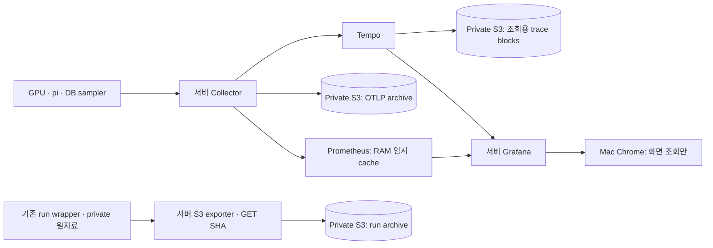

# Vast 서버 관측과 S3 영구 보관

Vast 또는 별도 Linux 서버에서 Collector·Tempo·Prometheus·Grafana를 실행한다. **Mac은 Grafana를 여는 클라이언트일 뿐 수집·보관 서버가 아니다.** GPU와 같은 호스트에 배치하면 GPU의 OTLP exporter는 서버 loopback을 사용하고 reverse SSH를 거치지 않는다. 다른 Linux 서버를 쓰는 경우에도 수집 연결의 수명은 Mac과 분리한다.



## 저장 정책

| 자료 | 영구 저장 | 서버 임시 상태 |
| --- | --- | --- |
| Trace 조회용 blocks | S3의 `tempo-query/` | Tempo WAL: 아직 flush되지 않은 데이터 |
| OTLP trace·metric·log | S3의 `otlp/` | Collector persistent 전송 대기열 |
| 원 SDK 이벤트·질문별 결과·실패·계측·source pin | S3의 `runs/` | 실행 중 run과 업로드 staging |
| Live PromQL 조회 | 별도 영구 TSDB 없음 | Prometheus RAM cache, 2시간/256MB |
| Grafana 상태 | dashboard/provisioning은 코드·암호는 secret | SQLite/session cache는 RAM |

Tempo 조회용 S3 blocks는 7일 retention이다. **영구 원본은 다른 prefix의 OTLP 및 full-run archive**이며 이 Compose는 해당 원본을 삭제하거나 lifecycle을 설정하지 않는다. 운영자가 archive prefix에 별도 만료 정책을 걸면 그 정책이 우선한다. Collector의 awss3 exporter는 0.119.0에서 alpha이며 Put 성공/queue drain만으로 원자료 보존을 완료 처리하지 않는다.

OTLP metric archive는 Prometheus TSDB가 아니다. RAM cache가 사라진 뒤 S3 자료를 기존 dashboard가 직접 PromQL로 조회할 수 있다고 주장하지 않는다. 장기 분석은 원자료를 서버에서 재계산하거나 별도 S3 지원 metric query backend가 필요하다. 본 구성에는 Mimir/Thanos를 추가하지 않았다. Collector 자체 metric과 recording rule이 모두 OTLP archive에 복제된다는 뜻도 아니다. 기존 run sampler의 metric snapshot과 receipt는 full-run archive에 보존한다.

전송 queue·WAL·미검증 raw는 장애 복구용 서버 버퍼다. 이를 영구 저장소라고 부르지 않으며 S3 GET 검증 전에 지우지 않는다. 신규 Mac 자동 다운로드는 사용하지 않는다. 이전 Mac raw/volume도 회수 검증 전에는 삭제하지 않는다.

## 서버에서 시작

저장소 root에서 실행한다. `--project-directory .`를 유지한다. GPU 이미지·모델·DB·pi runner를 새로 만들거나 다른 실험의 설정을 바꾸는 Compose가 아니다.

서버에 private mode0600 파일 두 개를 준비한다. `GARE2E_GRAFANA_PASSWORD_FILE`은 Grafana 암호 파일, `GARE2E_AWS_CREDENTIALS_FILE`은 **연구 S3 prefix에만 접근하는 서버용 AWS credentials 파일**이다. 개인 Mac의 전체 `.aws`, SSO cache, 다른 프로젝트 키를 복사하지 않는다. 파일의 `[default]` profile에 operator가 관리하는 credential을 제공하며, 단기 credential이면 갱신과 만료 감시도 서버에서 운영해야 한다. 원격 credential 갱신을 Mac에 의존하는 방식은 이 구성의 자율 보관 조건을 충족하지 않는다.

```bash
export AWS_REGION=<approved-region>
export GARE2E_S3_BUCKET=<approved-private-research-bucket>
export GARE2E_S3_PREFIX=<project/campaign-prefix>
export GARE2E_AWS_CREDENTIALS_FILE=<server-private-credentials-file>
export GARE2E_GRAFANA_PASSWORD_FILE=<server-private-grafana-password-file>

docker compose --project-directory . -p gare2e-vast-observer \
  -f docker/compose.vast-observability.yaml config --quiet
docker compose --project-directory . -p gare2e-vast-observer \
  -f docker/compose.vast-observability.yaml up -d
```

S3 설정이 없으면 Compose는 실패한다. 로컬 storage로 조용히 대체하지 않는다. 승인된 bucket의 region/role/prefix를 확인하고 다른 프로젝트 bucket은 사용하지 않는다. Tempo에는 List/Get/Put과 조회용 prefix에 필요한 Delete 권한, archive에는 Put/Get 권한을 분리한다. 실제 권한·암호화·만료·네트워크는 실행 서버에서 확인한다. File-backed secret의0600 파일을 읽도록 Tempo/Collector/Grafana는uid0이며 privileged/socket/host-root mount는 쓰지 않는다.

Vast managed container에 Docker daemon/socket이 없으면 같은 고정 버전의 Linux binary와 server 설정으로 기동한다. 기존 GPU Collector/sampler를 재구현하지 않고 loopback 목적지와 Docker 서비스 이름만 실제 port에 맞춘다. Mac Docker Desktop을 수집 서버로 대체하지 않는다. 모델/DB와 별도의 소유 observer process로 관리한다.

## 실험 시작·종료 보관 gate

기존 private exporter의 PUT→GET SHA 절차를 서버 AWS SDK credential chain으로 실행한다. Mac이 presigned URL을 계속 발행할 필요가 없다. `boto3`가 필요하며 비밀값을 인자나 결과 JSON에 넣지 않는다. CLI는 명시한 credential 파일의 완전한 키 쌍만 읽고, profile이 비어 있으면 실패한다. 다른 개인 profile이나 credential provider로 넘어가지 않는다. 명시한 process 환경 키 쌍은 우선한다. `AWS_REGION`은 `.env`의 기본값을 추측해 쓰지 말고 실제 버킷 지역과 맞춘다.

```bash
python3 docker/agentic-os-appliance/observability/vast/export_private_run.py \
  --preflight --s3-uri "s3://$GARE2E_S3_BUCKET/$GARE2E_S3_PREFIX"

# 기존 wrapper가 자손을 회수하고 raw를 닫은 뒤 실행. staging은 run 밖에 둔다.
python3 docker/agentic-os-appliance/observability/vast/export_private_run.py \
  --run "$RUN_ROOT" --output "$STAGING/run.private.tar.gz" \
  --s3-uri "s3://$GARE2E_S3_BUCKET/$GARE2E_S3_PREFIX"
```

Preflight는 내용이 없는 storage probe를 S3에 보존하고 GET SHA를 검증한다. Benchmark 증거가 아니다. 종료 시 full-run archive를 같은 run ID의 immutable key로 PUT하고 GET 전체 크기/SHA를 검증한다. 같은 key는 덮어쓰지 않는다. 거절·불일치·credential 만료는 nonzero/failed이며 source/staging을 남긴다. `--local-only`로 S3 성공을 대신하는 선택지는 없다. 검증한 staging/raw의 정리는 별도 소유 cleanup에서 수행하며 이 exporter가 자동 삭제하지 않는다.

awss3 연속 전송의 queue/retry와 이 원자료 보관 gate는 별개다. Exporter 실패나 queue drop은 run의 gap으로 기록한다. S3 권한이 없다면 새 유료 benchmark를 시작하지 않는다. 기존 serving/DB를 임의로 중지하지도 않는다.

## Mac에서 조회

공개 WAN에 metrics/OTLP를 노출하지 않고 필요한 화면만 local forward한다. Mac이 잠들어 연결이 끊겨도 서버 수집은 계속된다.

```bash
ssh -N -o ExitOnForwardFailure=yes \
  -i "$VAST_SSH_KEY" -p "$VAST_SSH_PORT" \
  -L "127.0.0.1:23000:127.0.0.1:23000" \
  "$VAST_SSH_USER@$VAST_SSH_HOST"
```

Compose Grafana는 server `127.0.0.1:23000`이다. Native 배치는 실제 port에 맞춘다. 브라우저는 `http://127.0.0.1:23000/d/gare2e-vast-workload`, admin/secret-file 인증과5초 갱신을 사용한다. 화면 조회용 forward이며 GPU→Mac reverse tunnel은 필요 없다.

## 실제 확인과 종료

실제 GPU/sample이 서버 Prometheus에 나타나고, Mac의 이전 수집 스택을 중지해도 timestamp가 진행되는지 확인한다. Tempo는 실제 trace/span/parent ID로 대조하고 S3 원자료는 GET SHA와 region/prefix를 기록한다. Service health·빈 queue·mock S3만으로 완료 판정하지 않는다. HTTP latency를 GPU kernel 시간으로 해석하거나 결측을0으로 채우지 않는다.

`down` 후 서버 cache/session은 사라질 수 있다. 미전송 WAL·queue는 named volume에 남긴다. S3 검증 전 `down -v`를 쓰지 않는다. Vast stop/destroy·S3 권한 변경·다른 인스턴스 조작은 각 owner 계약에 따른다.

설정 근거: [Tempo2.7.2 S3 config](https://github.com/grafana/tempo/blob/v2.7.2/tempodb/backend/s3/config.go), [Collector0.119 awss3](https://github.com/open-telemetry/opentelemetry-collector-contrib/blob/v0.119.0/exporter/awss3exporter/README.md).
