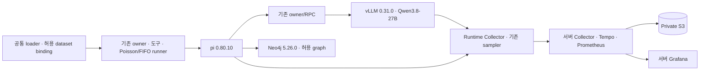

# Vast 전체 실험 이미지와 Compose

관측 스택에 **실제 설치 파일**을 연결한 구성이다. 단일 pi 세션을 직접 호출하는 기존 실행 경로, 공통 datasource, Poisson/FIFO 코드를 그대로 포함한다. Manager→specialist 계층은 추가하지 않는다. 기본 SDK용 root `compose.yaml`과 기존 vLLM 0.27.1 appliance는 변경하지 않는다.

| 구성 | 고정 기준 | 설치 경로 |
| --- | --- | --- |
| PyTorch / CUDA runtime | 2.13.0 / 13.0 | `base.Dockerfile`, 이전 검증 dependency image |
| vLLM | 0.31.0, compiled/APC | `constraints.txt`, `serve.sh` |
| 모델 | Qwen3.8-27B BF16, revision `1d4bf0f2ff6012fd82039f2fa52739d0dd7c60c0` | `model-pin.json`, `download-model.py` |
| pi SDK | `@earendil-works/pi-coding-agent` 0.80.10 | 저장소 `scripts/benchmarks/pi_native/package-lock.json`, `npm ci` |
| Neo4j | Community 5.26.0 / Python driver 5.28.2 | 배포 tar SHA 검증, `start.sh` |
| Collector | 0.119.0 | 공식 이미지의 binary를 build 단계에서 복사 |
| Tempo / Prometheus / Grafana | 2.7.2 / 2.55.1 / 11.5.1 | 관측 Compose의 버전 고정 이미지 |
| 공통 loader / 큐 | 현재 저장소 source | `scripts/benchmarks/load_benchmark_tasks.py`, `pi_native/` |

실행 바이너리 수백 MB를 Git에 넣지 않는다. Dockerfile에서 공식 이미지 또는 SHA를 확인한 배포본으로 설치하며, pi는 lockfile로 설치한다. 기본 dependency image는 기존 private registry의 immutable digest다. 레지스트리에 로그인해야 내려받을 수 있다. 아래 clean build 경로도 제공한다. upstream tag·시스템 패키지 전체를 영구 봉인한 것은 아니므로 clean build의 실제 image digest와 설치 버전은 실험 전에 따로 기록한다.



## 서버 준비와 설치

이 Compose는 **Docker daemon과 NVIDIA Container Toolkit이 있는 승인된 Linux GPU 호스트**에서 실행한다. Vast managed container 안에 Docker socket이 없으면 그대로 실행할 수 없다. 현재 57874888의 native 배포를 이 명령으로 덮어쓰거나 Docker-in-Docker를 설치하지 않는다. 현재 instance의 모델·DB를 중단하지 않은 채 PR의 설치 경로를 별도로 검증한다.

저장소 root에서 아래 함수를 사용한다. 비밀값을 `.env` 전체로 컨테이너에 주입하지 않는다. [관측 설정](../observability/vast/README.md)의 S3·Grafana secret 파일과 환경변수 외에 `GARE2E_NEO4J_PASSWORD_FILE`을 지정한다. 모두 서버 전용 파일이다.

```bash
dc() {
  docker compose --project-directory . -p gare2e-vast \
    -f docker/compose.vast-observability.yaml \
    -f docker/compose.vast-runtime.yaml "$@"
}
dc config --quiet
export GARE2E_SOURCE_REVISION="$(git rev-parse HEAD)"
dc build runtime
dc run --rm --no-deps --entrypoint python runtime \
  /opt/gare2e-pilot/source/docker/agentic-os-appliance/vast-runtime/verify-install.py
dc --profile setup run --rm model-download
dc up -d tempo otel-collector prometheus grafana runtime
```

`verify-install.py`는 CPU 검사지만 `runtime` 서비스에 GPU reservation이 있으므로 위 Compose 명령에는 GPU 호스트가 필요하다. GPU 없이 설치만 확인하려면 `docker run --rm --platform linux/amd64 --entrypoint python gare2e-vast:runtime031-pi08010 /opt/gare2e-pilot/source/docker/agentic-os-appliance/vast-runtime/verify-install.py`를 사용한다.

모델은 setup profile에서만 내려받는다. 이후 runtime에는 model volume을 읽기 전용으로 연결한다. DB·model·Collector·기존 CPU/GPU sampler의 health는 설치 상태 검사이며, 실제 Responses→tool→다음 turn·scorer·S3 readback의 본실험 gate를 대신하지 않는다. Runtime은 시작 전 S3 PUT→GET 검사를 수행하고 실패하면 모델을 시작하지 않는다. engine observer는 실제 vLLM 0.31.0 전용이며 버전 검사를 해제하지 않는다.

기본 runtime은 TP1, engine `max-num-seqs=4`, context 32,768이다. **Episode C4와 engine cap은 별도 설정**이다. High thinking·출력·누적 token 예산은 기존 pi config의 명시적 profile로 전달한다. 모델 context 1M·compaction은 이 이미지가 구현하거나 검증했다고 표시하지 않는다.

## Private registry 없이 dependency layer 재빌드

```bash
docker build --platform linux/amd64 \
  -f docker/agentic-os-appliance/vast-runtime/base.Dockerfile \
  -t gare2e-vast:deps031 .
GARE2E_RUNTIME_BASE=gare2e-vast:deps031 dc build runtime
```

별도의 `source.tar.gz`나 로컬 실험 폴더 없이 현재 저장소 source로 빌드한다. Dockerfile별 allowlist로 `.env`, 키, untracked model/결과, `node_modules`를 build context에서 제외한다. 모델 가중치·질문·gold·AWS 키는 image에 포함하지 않는다.

## Datasource와 실제 pi 실행

6종 데이터 형식의 **기존 공통 loader**를 설치한 것이며, private finance·FinBench·FinDER·GRBench 등의 원본이 자동 제공되거나 DB에 모두 import되는 것은 아니다. 운영자가 승인된 snapshot 경로를 `GARE2E_DATASET_DIR`로 제공한다. Dataset마다 기존 importer와 도구를 사용하고 episode-local graph의 범위를 유지한다. 단일 공유 DB로 임의 합치지 않는다.

```bash
dc --profile dataset run --rm datasource --help
# 원 loader 옵션과 snapshot 경로를 지정한다. 원본은 /datasets에 read-only mount된다.
```

`pi` profile은 기존 `native_case.mjs` 실행 경로다. `GARE2E_PI_CONFIG`는 worker 전용 config, `GARE2E_WORKER_DIR`는 기존 승인된 extension/owner 연결 폴더이며 `/worker`에 read-only mount된다. Evaluator/gold는 이 mount에 넣지 않는다. Config의 extension 경로·owner endpoint·system prompt·tool 이름·예산은 실제 배포와 일치해야 한다. 이 Compose가 private owner/RPC를 새로 만들지는 않는다.

Config의 `output`은 아직 없는 `/artifacts/<고유-run-id>`여야 하고, `cwd`는 worker용 격리 경로로 지정한다. `pi`는 runtime의 network namespace를 공유하므로 기존 loopback Responses·Bolt 경로를 사용할 수 있다. 기존 owner가 별도 프로세스라면 원 owner launcher로 먼저 연결한다. `run-pi.sh`는 SDK 단일-session용이며 Poisson cohort/owner supervisor를 대신하지 않는다. 코호트는 포함된 기존 `cohort_adapter.run_cohort_queue`와 원 runner에서 실행한다.

Config의 `env.PI_TRACE_CONTEXT_FILE`은 기존 extension이 실제로 쓰는 trace context 파일을 가리켜야 한다. `trace_id`, `root_span_id`, `experiment`의 project/campaign/experiment/run ID를 요구하고 run ID는 output 디렉터리 이름과 일치해야 한다. 이 파일 없이 trace 연결을 완료한 것으로 진행하지 않는다. 기존 `run_observed_experiment.py --external-collector`와 callback span exporter를 함께 포함해 실제 Collector snapshot·queue·workload 종료를 기록한다. 전송 확인은 owner/engine settlement 또는 benchmark 정답 판정과 별개다.

```bash
dc --profile experiment run --rm pi
```

S3 preflight 실패 시 세션을 시작하지 않는다. 실행 실패도 원 exit status와 raw를 보존하며, 종료 후 full-run archive PUT→전체 GET SHA를 수행한다. 원자료나 staging을 자동 삭제하지 않는다. 권한 부족을 `local-only` 성공으로 대체하지 않는다. 세션 종료만으로 owner/engine settlement까지 검증됐다고 주장하지 않는다.

Benchmark 정답·evidence·외부 SLO 평가는 기존 evaluator에서 수행한다. 이 CLI의 종료 성공을 정답이나 6종 benchmark 전체 통과로 해석하지 않는다. Source revision 환경변수를 생략하면 image label은 `unrecorded`이며 dependency image의 과거 source pin을 새 source의 pin으로 재사용하지 않는다. 실제 실험에서는 clean checkout의 revision·image digest·config hash를 기존 run manifest에 봉인한다.

Archive에는 해당 실행 중 기존 runtime sampler CSV·memory/graph-system JSONL·engine observer JSONL의 byte 구간과 원 경로·offset·SHA도 넣는다. 연속 기록을 요청별 이벤트로 임의 복원하지 않으며, 상관 분석은 원 timestamp/ID를 사용한다. TERM/INT는 workload group에 전달하고 정리 후 보관을 시도한다. 강제 KILL·host 장애·보관 실패에서는 미회수 raw를 서버에 남긴다. Stop grace는 3분이며 업로드 완료를 무조건 보장하는 시간은 아니다.

## 버전과 검증 범위

`verify-install.py`는 vLLM·torch·driver·S3 SDK·pi 실제 import와 공통 loader CLI를 확인한다. CPU에서의 설치 검사이며 GPU generation·DB 데이터 적재·6종 전체 E2E·동시성·취소 경계의 통과가 아니다. 새 이미지/host에서의 실제 native gate와 원 workload·trace·S3 gate는 여전히 필요하다.

전체 Compose는 upstream의 [GPU reservation](https://docs.docker.com/compose/how-tos/gpu-support/)을 사용한다. vLLM 이미지/host 조건은 [공식 Docker 문서](https://docs.vllm.ai/en/latest/deployment/docker/)를 따른다. Mac은 Grafana 화면 조회만 하며 queue/WAL/raw는 회수 전 서버 임시 상태, 영구 보존은 S3다. 승인 없이 live instance를 교체·정지·삭제하지 않는다.
