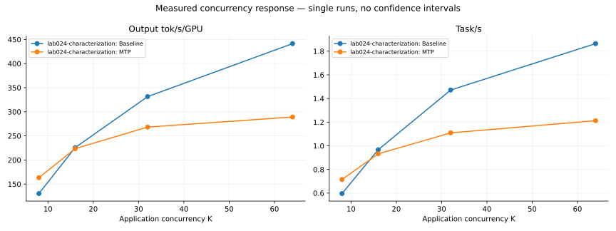
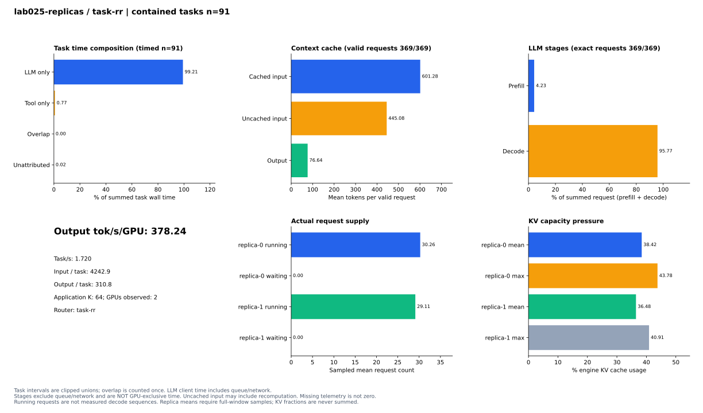
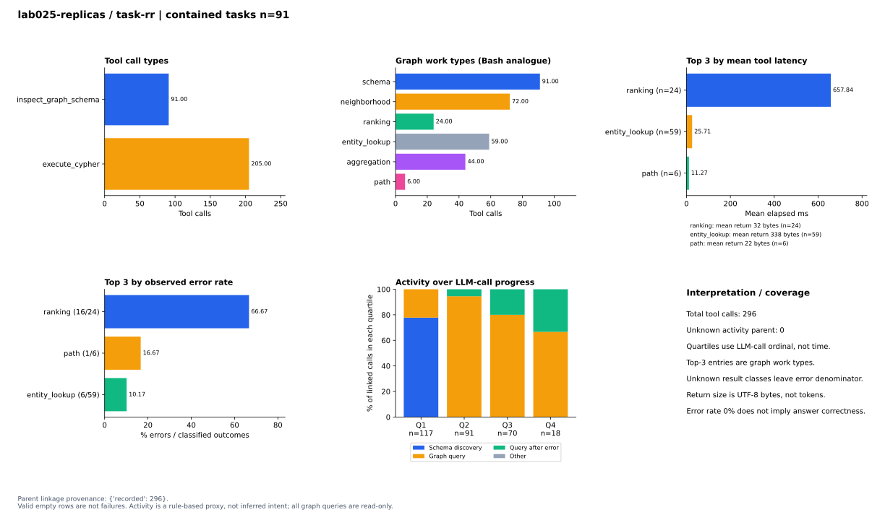
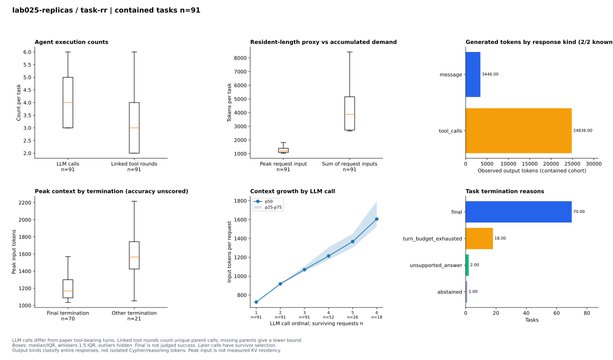

# Graph Agentic RAG: observability, metrics, and harness

이 디렉터리는 다른 사람이나 coding agent가 같은 결과와 계측 정의를 확인하고
실험을 이어받는 진입점입니다. **30개 비교 조건**의 결과를 Runtime / Tool / Agent
세 관점으로 분석합니다. 주지표는 output tok/s/GPU이며 task/s와 task당 입력·출력
token 수를 함께 기록합니다.

| 필요한 것 | 진입점 |
| --- | --- |
| 공용 실험 비교 → 개별 task → 근거, Perfetto·Nsight 다운로드 | [실험 플랫폼 실행·기여 가이드](EXPERIMENT_PLATFORM.md) |
| 조건을 선택하며 차트 보기 | [차트 보고서](reports/characterization-charts/index.html) |
| 분모, 단위, 누락 처리, 논문 그림과의 대응 | [차트 측정 정의](reports/characterization-charts/README.md) |
| Graph 저장 구조·procedure·스레드·하드웨어 관측 | [GRAPH_SYSTEM_OBSERVABILITY.md](GRAPH_SYSTEM_OBSERVABILITY.md) |
| 전체 observability 계약과 미관측 지표 | [OBSERVABILITY_FACTORS.md](OBSERVABILITY_FACTORS.md) |
| LLM→tool→다음 LLM의 task별 timeline | [최신 실행 보고서](reports/lab025-replicas/index.html) |
| 실험 조건, 결과, 수집·종료 검증 | [Lab025 결과](reports/lab025-replicas/README.md) |
| 새 checkout에서 하네스 사용 | [HARNESS.md](HARNESS.md) |
| SF1 동결 ZIP의 무결성·실행 경계 확인 | [SF1_HANDOFF.md](SF1_HANDOFF.md) |
| GUG·FinBench 검토 요약·원본 S3 위치 | [실험 요약과 manifest](../../experiments/gug-20261030-20261102/README.md) |
| Coding agent 실행·재개 규칙 | [AGENTS.md](AGENTS.md) |
| 최신 인계, 요청, 비용 | [HANDOFF.md](HANDOFF.md), [BOARD](lab/BOARD.md), [LEDGER](lab/LEDGER.md) |

GitHub는 HTML을 웹 앱으로 실행하지 않으므로 저장소를 clone하거나 ZIP으로 받은
뒤 `reports/characterization-charts/index.html`을 브라우저로 여세요. 아래 SVG는
GitHub 문서에서도 바로 볼 수 있습니다. 저장소 접근 권한을 가진 동료에게 이 문서
링크를 공유하면 됩니다. AWS/Vast 계정 없이 저장된 결과와 차트를 볼 수 있습니다.

## 동시성과 처리량

## 1. Runtime Performance Characterization

Task의 LLM/tool 시간, context cache, prefill/decode, 처리량, 실제 running/waiting
요청 수와 backend별 KV 사용률을 분리합니다. 요청 시간은 GPU 독점 시간이 아닙니다.

## 2. Tool Call Characterization

Tool 이름과 Cypher 작업 유형, 평균 비용·오류율 상위3개, 진행도별 활동을 봅니다.
정상적인 빈 결과는 실패가 아니며 반환 bytes는 token 수와 구분합니다.

## 3. Agent Execution Characterization

LLM 호출과 tool-bearing round, 최대 입력과 누적 입력, 생성량, 종료 유형과
턴별 context 증가를 봅니다. `final`은 정답 성공 판정이 아닙니다.

모든 조건은 탐색적 단일 실행입니다. 실제 긴 context/offloading, grammar CPU,
engine 내부 decode sequence/커널 공백은 아직 실측하지 않았습니다. 원본 보고서의
미관측·수집 한계와 source/파일 hash를 유지하며, 그래프만으로 인과관계를 확정하지 않습니다.
