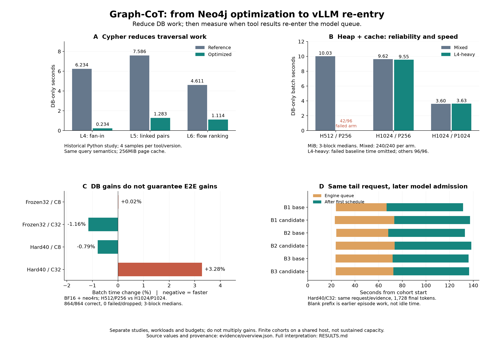

# Graph-CoT optimization lab: Neo4j → tool runtime → vLLM

**2026-11-05 연구 정리·실행 종료:** [전체 인수인계와 남은 과제](PROJECT_CLOSEOUT.md).
원래 Vast 인스턴스는 Stop 완료이며, 재현은 새 환경 복원 절차를 사용하세요.

**새 인스턴스로 이전:** [준비물·복원·neo4rs·재현 명령 순서](FRESH_INSTANCE_RUNBOOK.md).

금융 그래프 tool call의 비용을 분해하고 최적화를 검증하는 재사용 예제입니다.
GPU/DB 없는 첫 경로와 실제 서비스 측정 경로를 분리합니다. 기존 SEOCHO SDK,
DozerDB 기본 backend나 agent routing을 바꾸지 않습니다. 이 예제의 측정 근거는
별도의 Neo4j Community5.26/SF1 연구이며 DozerDB 성능을 주장하지 않습니다.

**출발점:** [튜토리얼](TUTORIAL.md) → [실험 결과](RESULTS.md) →
[실험 프로토콜](PROTOCOL.md) → [vLLM 전달 계약](VLLM_HANDOFF.md).

**인스턴스 종료 전 연구 보존:** [전체 결과·원시 자료 복구 안내](preservation/README.md),
[과거 결과/방법 보고서21개](preservation/reports/README.md),
[56개 연구 결과 폴더 목록](preservation/STUDIES.md). 원시 자료는 비공개 저장소의
암호화 Release 첨부에 보존하며 복구 키는 별도로 보관합니다.

**노드·관계로 설명하기:** [L4–L6 전/후 애니메이션·63초 MP4·재생성 코드](animation/README.md).



## 3분 offline 시작

저장소 root에서 Python3.10+로 실행합니다. 아래 두 명령은 표준 라이브러리만
사용하며 외부 서비스·인증·네트워크가 필요 없습니다.

```bash
python3 examples/graphcot_optimization/lab.py verify
python3 examples/graphcot_optimization/lab.py demo
```

`verify`: source SHA/요약 분모와 세 query set의 바인딩을 확인합니다.
`demo`: 합성 graph에서 병렬 송금이 DISTINCT 수취인1행으로 반환되는 oracle
계약을 보여줍니다. **둘 다 실제 Cypher 실행/성능 검증이 아닙니다.**

[guided notebook](../../tutorials/graphcot_optimization.ipynb)도 같은 offline 경로를 사용합니다.

## 무엇이 포함되어 있나요?

| 경로 | 내용 |
|---|---|
| `core/` | 실제8tool registry, schema 검증, 독립 graph oracle, contract export |
| `queries/financial_tools/` | 기준 Cypher; parameter만 받아 실행 |
| `queries/sf1_optimized/` | 과거 E2E 검증한 재작성; 전역 최적점이 아님 |
| `queries/hard_tools_optimized/` | 별도 어려운 인자 연구 후보; 위와 자동 혼합하지 않음 |
| `neo4rs_adapter/` | explicit transaction HTTP adapter와 lease patch, Cargo lock |
| `lab.py` | demo/bind/export-contract/유한 DB cohort 측정 |
| `evidence/` | 검토된 수치 요약·원본 코드 hash·patch 출처 |
| `render.py`, `assets/` | 모델/DB 없이 재생성하는 한 장 PNG/PDF |

전체 DB store/FinBench 원본·snapshot·모델 weights·개인 접속 주소·credentials·
raw prompt/answer/log·수GB archive·Beads state는 포함하지 않습니다.
새 live 재현에는 본인에게 허용된 데이터와 모델/서비스를 준비해야 합니다.

## 선택 의존성 및 차트

```bash
python3 -m venv .venv-graphcot
source .venv-graphcot/bin/activate
python -m pip install -r examples/graphcot_optimization/requirements.txt
python examples/graphcot_optimization/render.py --output /tmp/graphcot-figures-new
```

출력 폴더가 이미 있으면 거부합니다. 원본 자료를 덮어쓰지 않습니다. 설치는
네트워크가 필요하지만 설치 후 chart 재생성은 offline입니다.

## 현재 근거와 한계

- Cypher/메모리 조합은 DB 실행량·시간과 성공률을 개선했습니다.
- 실제 고정BF16/neo4rs E2E는864/864정답,0실패/drop이지만 Hard40/C32
  배치시간은132.933→137.297초(+3.28%)였습니다.
- 사용자C32에서도 tool HTTP overlap peak는3~4였습니다. DB-only C32와 다릅니다.
- 물리 disk 포화, NUMA, 순수 GC, CPU scheduler compute 포화 또는 KV 재계산
  원인은 입증하지 않았습니다. finite cohort는 steady capacity가 아닙니다.
- 초기 패키징에서는 live DB/LLM을 실행하지 않았습니다. 이후 복원 helper는 격리된
  소형 Neo4j에서 검증했습니다. 전체 SF1 새 VM 복원과 GPU E2E 재측정은 미실행입니다.

## Third-party / provenance

원본8tool/선정Cypher/adapter source는 `evidence/source-manifest.json`에
byte SHA를 기록했습니다. `parameter_oracle.py`의 hash helper import만 같은
구현의 `financial_tools.sha`로 옮겼으며 원본 hash/변경 이유를 기록했습니다.
신규 `lab.py`는 portable wrapper이며 과거 측정 controller의 byte 복제가 아닙니다.

neo4rs0.8.0은 upstream MIT metadata를 따릅니다. vendored crate 전체를
재배포하지 않고 `prepare_neo4rs.py`가 고정 archive SHA 검증 후 기록된 patch를
적용합니다. [upstream](https://github.com/neo4j-labs/neo4rs/tree/v0.8.0),
[patch provenance](neo4rs_adapter/vendor/PATCH_PROVENANCE.json).
Neo4j/FinBench/model 배포·라이선스는 각각의 원출처 조건을 확인하세요.
