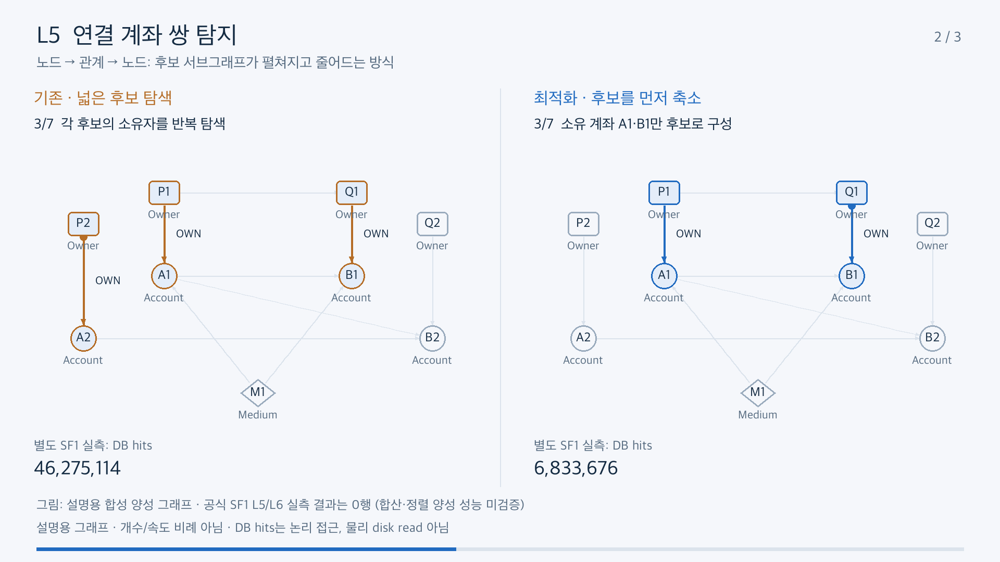

# L4–L6 서브그래프 탐색: 전 / 후

실행계획 상자 대신 **node → relationship → node**를 따라가는 모습을 비교합니다.
같은 예시 그래프를 양쪽에 놓고 탐색하는 관계, 제외되는 계좌, 선택된 계좌 쌍을 표시합니다.

- [MP4 다운로드/보기](../assets/l4-l6-subgraph-before-after.mp4): 1920×1080,24fps,63초, H.264/yuv420p, 무음. 설명 문구가 영상에 포함됩니다.
- [자막 SRT](../assets/l4-l6-subgraph-before-after.srt)
- [대화형 비교 HTML](subgraph-before-after.html): 다운로드 후 브라우저에서 열기. 시나리오 선택·재생/일시정지·단계 이동 지원.
- [영상 해시·검증 기록](../assets/l4-l6-subgraph-before-after.json)



| 영상 구간 | 전달할 내용 |
|---|---|
|00:00–00:21 L4|전체 송금 집계와 수신 계좌별 탐색을 비교. 작은 LIMIT를 채우면 남은 수신 계좌의 관계 탐색을 생략|
|00:21–00:42 L5|송금 계좌 쌍에서 시작하는 경로와 보증 관계 → 소유 계좌 → 공유 접속·송금 존재 검사를 비교|
|00:42–01:03 L6|보증 기반 후보 축소, 상환 계좌 제외, DISTINCT 이후 양방향 송금 합계 계약 유지|

## 그림과 실측의 경계

**그림은 설명용 합성 데이터이며 SF1 profiler의 edge-by-edge trace가 아닙니다.**
점·노드·재생 속도는 실제 개수나 실행 시간에 비례하지 않습니다. Cypher optimizer의
실제 predicate 순서를 그대로 재연한다고 해석하지 마세요.

- L4 그림은 `min_senders=2, LIMIT=2`, 별도 SF1 v0 측정은 `LIMIT=5`입니다.
  그림은 scan 전체 비용을 생략해 개선된 듯 보이는 연출을 하지 않도록, 두 경로 모두
  전체 계좌 후보가 있는 상태에서 시작합니다. 실측은 Account204,771개 scan 후 정렬,
  7개 계좌/20개 송금 집계로5개 결과를 확보했습니다.
- L5/L6 그림은 관계 조건을 설명하는 **양성 예시**입니다. 공식 SF1 측정 결과는 모두0행입니다.
  실측 개선은 후보 배제 비용 감소이며, 양성 대량 합산/정렬 성능의 증거가 아닙니다.
- 고정된 하단 수치는 [보존된 SF1 보고서](../preservation/reports/results__sf1_optimization_a__final-evidence__FINDINGS.md)의 별도 PROFILE v0 총 DB hits입니다.
  L4 7,977,853→614,551; L5 46,275,114→6,833,676; L6 26,012,494→6,572,609.
  DB hits는 논리 접근 횟수이며 물리 disk read가 아닙니다. E2E speedup으로 환산하지 않습니다.

## 재생성

코드·데이터·MP4를 저장소에 함께 보관하므로 원래 GPU 인스턴스가 필요 없습니다.
`subgraph-data.json`은 공개해도 되는 작은 합성 그래프이며 실제 계좌/개인정보가 아닙니다.
HTML과 MP4는 같은 노드/관계/7단계 데이터를 사용하며 렌더러는 각각 SVG/Pillow입니다.

```bash
# 별도 venv 권장. ffmpeg는 운영체제 패키지 관리자로 설치합니다.
python3 -m venv /path/to/new-animation-venv
source /path/to/new-animation-venv/bin/activate
python -m pip install 'Pillow==11.3.0'
python examples/graphcot_optimization/animation/render_video.py \
  --output /path/to/new-output/subgraph.mp4 \
  --font /path/to/NotoSansCJK-Regular.ttc --fps 24
```

한글을 지원하는 본인 소유 font를 지정합니다. 실제 배포 영상은 Apple SD Gothic Neo로
렌더링했으며 font 파일은 저장소에 포함하지 않습니다. 다른 font/ffmpeg 버전에서는 pixel/
영상 해시가 달라질 수 있습니다. 기존 output은 덮어쓰지 않습니다. PNG 중간/최종 검토용
6장과 MP4 해시 receipt가 함께 생성됩니다.

Inline source는 아래 명령으로 재생성합니다. standalone HTML은 이미 포함되어 있어
플러그인 없이 열 수 있습니다. 새 fragment를 standalone로 export할 때는 visualize
스킬의 `scripts/render.py` 경로를 `VISUALIZE_RENDERER`로 지정합니다.

```bash
python examples/graphcot_optimization/animation/build_fragment.py \
  --output /path/to/new-output/subgraph-fragment.html
python "$VISUALIZE_RENDERER" /path/to/new-output/subgraph-fragment.html \
  /path/to/new-output/subgraph.html
```

## 확인 범위

- graph의 edge/phase 참조·7단계 수 검증, Python compile/Ruff 통과.
- 실제 Chrome에서 SVG 표시, 시나리오 전환, 단계 이동, 자동 재생/일시정지,
  390px 모바일 가로 넘침 없음 확인. JavaScript 오류 없음.
- 각 장의 중간/최종 프레임에서 한글·관계 방향·양방향 곡선·조건 표시를 시각 검토.
- ffprobe의 H.264/1080p/24fps/yuv420p/63초 확인, 전체 영상 decode 검사.
- DB/model을 새로 실행하지 않았으며 기존 성능 결과는 변경하지 않았습니다.
