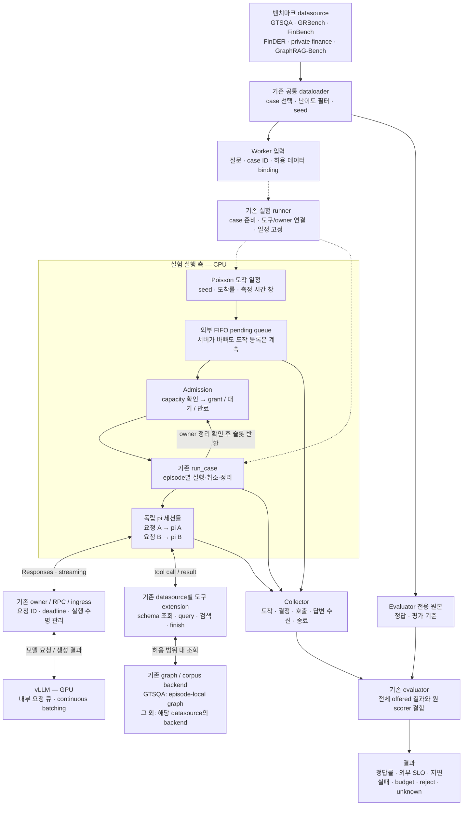
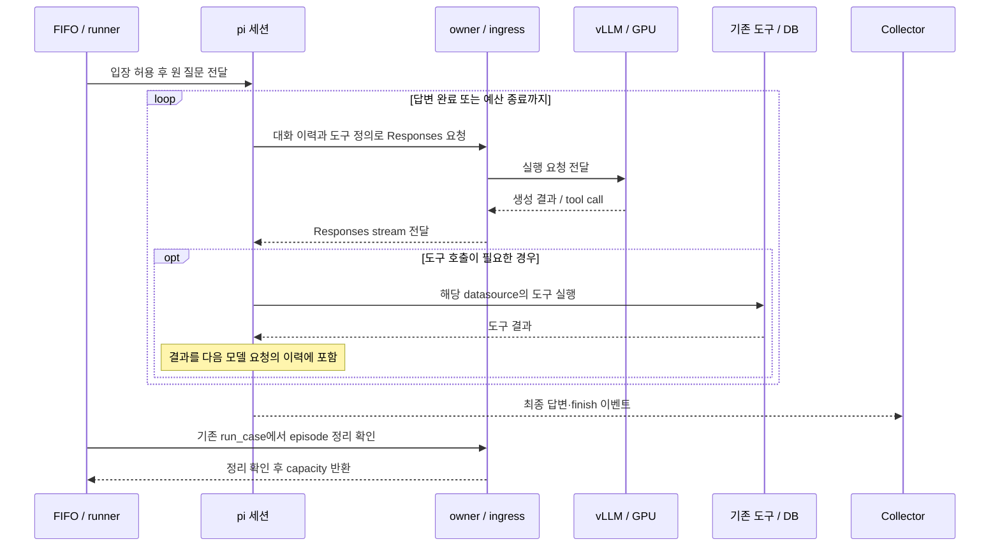

# 기존 pi SDK·datasource·Poisson/FIFO 실험 구성

계속 실험해 온 단일 pi 세션 실행 경로를 저장소에서 재사용할 수 있도록 정리한 디렉터리다. 질문을 pi 세션 하나에 직접 전달하고 기존 도구와 owner/RPC를 사용한다. Manager→specialist 계층을 새로 만들지 않으며, 저장소의 제품용 OpenAI Agents runtime도 변경하지 않는다.

**기존 경로의 실험 이력과 이번 PR 버전의 검증 범위는 구분한다.** 기존 pi·graph 도구·owner/RPC·Poisson/FIFO 경로에는 실제 GPU 실험 이력이 있다. 이번 PR에서는 이 코드를 옮기고 설정을 일반화한 부분을 로컬에서 검증했다. 이 PR 버전으로 GPU·DB·owner 전체를 다시 연결한 실행은 아직 하지 않았다. 따라서 기존 경로 전체가 미검증이라는 뜻은 아니다.

## 시스템 아키텍처

요청마다 독립적인 pi 세션 하나가 LLM과 도구를 반복 호출한다. 점선은 기존 배포 runner에서 연결하는 부분이다. DB 적재와 owner 실행을 이 PR이 자동 구성하는 것은 아니다.



### 요청 하나의 실행 순서



### 동시성의 세 층

| 층 | 제어 대상 |
|---|---|
| Poisson 도착률 | 초당 들어오는 새 episode 수 |
| FIFO capacity, 예: C4 | 동시에 입장해 있는 pi episode 수 |
| vLLM scheduler | episode들이 만든 모델 요청의 배칭·GPU 실행 |

C4는 모델 요청 4개를 항상 동시에 실행한다는 뜻이 아니다. 어떤 pi는 DB를 기다리고 다른 pi는 thinking을 생성하며, 한 episode도 도구 왕복으로 모델을 여러 번 호출한다. FIFO calibration은 이 전체 서비스 구성에서 도착률에 따른 대기열과 완료율을 측정한다.

추후 실험 pod와 Neo4j DB pod를 분리할 때는 실행 측과 DB backend를 별도로 배포한다. 기존 GTSQA의 episode-local graph를 하나의 공유 DB로 합치는 변경은 데이터 접근 범위와 조회 의미를 별도로 검증해야 한다.

## 구성과 역할

- `native_case.mjs`: 기존 SessionManager, extension 로딩, 도구, stateless Responses, collector 이벤트, abort/shutdown, 응답과 정리 시각의 구분을 유지한다. 배포 환경에서 **기존 extension과 owner/RPC 설정**을 전달한다.
- `../load_benchmark_tasks.py`: 기존 GTSQA·GRBench·FinBench·FinDER·private finance·GraphRAG-Bench의 공통 loader다. 원래 adapter를 재사용하고, 정답이 포함된 payload는 evaluator 쪽에 둔다.
- `datasource.request_for`: 원 질문과 case/snapshot 연결 정보만 worker 입력으로 만든다. GTSQA는 선택한 원 graph case의 질문을, FinBench는 account/scale 값이 이미 반영된 질문을 전달한다. 데이터 적재와 도구 연결은 기존 datasource 구성을 사용한다.
- `arrival_seam.py`: 기존 seed 기반 exponential 간격의 고정 건수 일정과 시간 창 기반 Poisson 일정을 유지한다. Collector 시각, 최초 입장 가능 시점, 비차단 재검사, FIFO capacity를 기록하며 비교 arm에 같은 일정을 제공한다.
- `cohort_adapter.run_cohort_queue`: **기존** `run_case`, `prepared`, owner 객체를 호출한다. Static calibration에는 forecast producer가 필요 없고, 나머지 정책 arm에는 동결한 producer가 필요하다.
- `answer_receipt.py`: collector가 실제로 받은 finish 이벤트 시각을 사용한다. Cleanup 시각을 최종 답변 수신 시각으로 대체하지 않는다.

`run_case`는 기존 owner 계약을 지키는 실행 callback이어야 한다. Exit 0/86을 반환하기 전에 owner의 해당 episode를 정리하고, 취소와 campaign 종료시각을 따라야 한다. 예외나 정리 여부가 불확실한 결과가 발생하면 추가 입장을 중단하고 unknown을 보존한다. SDK 프로세스 종료만으로 engine/GPU/KV 정리까지 완료됐다고 판단하지 않는다.

Private owner 설정, 데이터셋 snapshot, 정답, campaign 상태와 새 Neo4j importer는 이 패키지에 포함하지 않는다. 각 datasource에 연결된 기존 도구 extension과 evaluator를 사용한다. GTSQA 전용 도구를 다른 데이터셋에 일괄 적용하지 않는다. 6종 loader 검사는 각 데이터 형식의 호환성을 확인하는 것이며, 6종 DB 실서비스 실행을 대신하지 않는다.

## 설치와 실행

```sh
npm ci --prefix scripts/benchmarks/pi_native --ignore-scripts
node scripts/benchmarks/pi_native/native_case.mjs /path/to/private-config.json
```

기존 owner runner에서 다음 실행 설정을 전달한다.

```json
{
  "output": "/path/to/new-run",
  "cwd": "/path/to/isolated-model-context",
  "extension": "/path/to/existing/graph-extension/entry.ts",
  "question": "원 datasource 질문",
  "system_prompt": "기존에 고정한 benchmark system prompt",
  "env": {},
  "tool_names": ["inspect_graph_schema", "execute_graph_query", "finish_task"]
}
```

Session·episode·model·endpoint·private RPC 연결은 기존 owner 환경을 상속한다. 인증정보를 위 JSON에 복사하지 않는다. 선택적으로 지정하는 `sdk` 경로도 고정 버전 pi 0.80.10이어야 한다. 다른 datasource의 기존 extension을 사용할 때는 해당 도구 이름을 전달한다. Bash나 파일시스템 도구를 자동으로 추가하지 않는다. 출력은 private 권한으로 생성하며 같은 세션 디렉터리에 중복 실행하는 것을 막는다.

`profile`을 생략하면 과거 설정을 유지한다: 요청 8회, 출력 512 tokens, 누적 65,536 tokens, context 32,768, deadline 120,000ms, thinking off, temperature 0, compaction off.

`profile.mjs`에서 설정을 검증하고 환경변수로 연결한다. 별도 등록한 장시간 실행 arm에는 다음과 같이 모든 필드를 지정한다.

```json
{
  "max_requests": 512,
  "max_output_tokens": 32768,
  "max_total_tokens": 67108864,
  "context_window": 262144,
  "deadline_ms": 7200000,
  "thinking": "high",
  "temperature": 1,
  "compaction": false
}
```

High는 고정된 Qwen template의 `xhigh`로 명시적으로 변환한다. 기존 extension이 예산에 맞춰 더 작게 예약한 출력 한도는 유지한다. 같은 설정을 **배포 owner ingress에서도 허용해야 한다.** 이 패키지가 owner의 고정된 요청 검사를 완화하지는 않는다. Profile 변경과 campaign/GPU 사용 승인도 별개다.

누적 token 정산은 기존 extension이 담당한다. 기존 입력량 추정은 정확한 tokenizer 기반 hard cap이 아니며, 출력 한도에는 reasoning tokens도 포함된다.

Auto-compaction은 요약 요청을 기존 budget·owner 정산 훅에 연결하기 전까지 설정을 거부한다. Context 262,144 초과도 실제 모델 확장을 검증하기 전까지 거부한다. 이 두 기능은 이번 변경에서 구현 완료로 표시하지 않는다.

## FIFO calibration 연결

기존 고정 건수 파일럿에는 `schedule(case_ids, seed, rate)`를, 고정된 도착 시간 창에는 `duration_schedule(case_ids, seed, rate, warmup_s, measurement_s)`를 사용한다. 실행 전에 일정을 저장하고, 기존 `run_case`, 준비된 case, owner, 외부 deadline, campaign 절대 종료시각과 함께 `run_cohort_queue`에 전달한다.

고정 건수 파일럿은 첫 요청을 시각 0에 넣고, 시간 창 모드는 첫 요청의 도착 간격부터 표본추출한다. 같은 질문을 순환해서 사용하는 것은 개발 반복이며 독립적인 새 평가 표본이 아니다.

Static calibration 계약에는 `arms: ["static"]`, 양수 `capacity`, 그리고 `forecast_hold_ns`, `aging_ns`, `recheck_ns`, `forecast_ttl_ns`, `demand_threshold_tokens`가 필요하다. FIFO에서는 soft hold를 0으로 둔다. 함께 보존한 정책 helper는 기존 호출과의 호환성을 위한 코드이며, 새롭게 보정한 PS/PSG 기준선이나 성능 결과를 의미하지 않는다.

전체 offered의 실패·거절·unknown을 보존한다. 도착 등록은 admission보다 먼저 처리하고, hold는 루프를 멈추는 sleep이 아니라 재검사 상태로 기록한다. 외부 SLO의 원점은 예정 도착시각이다. 실행 중인 작업을 큐에서 해제하려면 owner 정리가 확인돼야 하므로, HTTP가 끝났다는 이유만으로 `run_case`를 먼저 반환하지 않는다.

## 검증

```sh
PYTHONPATH=src python -m pytest -q scripts/benchmarks/test_load_benchmark_tasks.py scripts/benchmarks/pi_native/tests
npm test --prefix scripts/benchmarks/pi_native
```

이번 PR의 로컬 검사는 다음을 확인한다.

- 실제 pi SDK subprocess와 loopback scripted SSE를 사용한 도구 왕복, call/result ID 연결, thinking payload, shutdown
- 6종 합성 데이터 형식의 원 loader 호환성과 worker 입력의 정답 제외
- 기존 큐에서 재현 가능한 도착 일정, FIFO, hold 중 도착 등록, capacity, deadline 거절
- 불완전한 답변 수신 기록을 성공으로 처리하지 않는 동작

모델 endpoint와 도구를 fixture로 대체한 검사는 이번 코드의 연결·계약 검증이다. 기존 실제 실험 이력은 유지하되, 이 검사를 새 버전의 GPU 호환성·실제 owner/RPC 정리·6종 DB 연결·처리량·benchmark 정답률의 실측 근거로 확대하지 않는다. 새 배포에서는 기존 GPU 검증 절차를 따른다.

코드 출처는 10월 최종 reference-reset 실행본의 native/queue와 기존 common loader다. 연구 원자료와 결과는 재배포하지 않는다.
